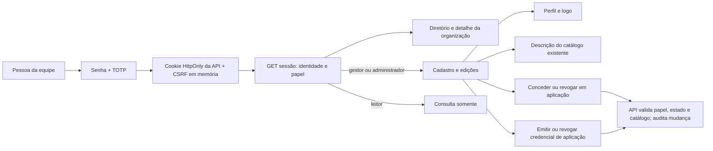
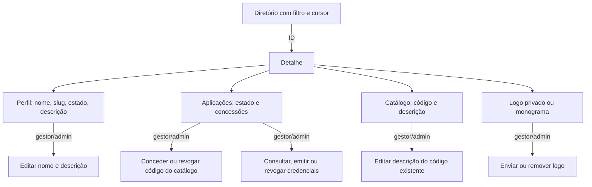
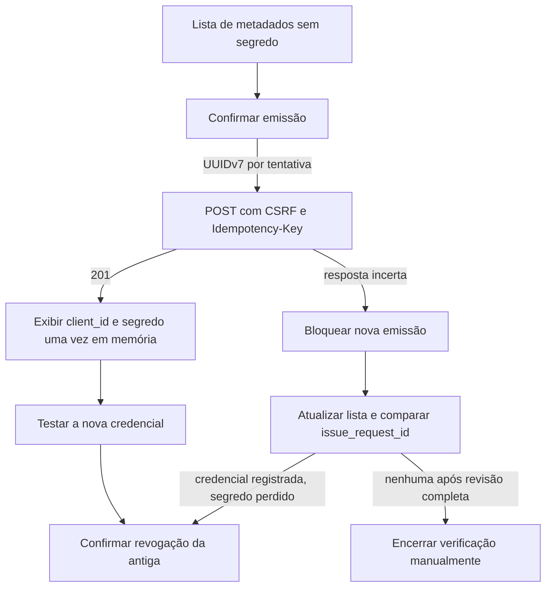
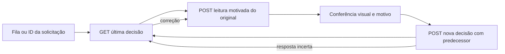
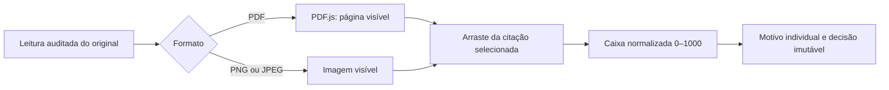

# Área da equipe: desenho e estado real

## Contas de provedores de análise (em integração)

Em 21/10/2026, a tela [AnalysisProviders.tsx](../src/AnalysisProviders.tsx) foi preparada para o papel `administrator`. Ela cadastra contas separadas para Gemini via JSON de conta de serviço ou chave de API, OpenAI via chave e API customizada compatível com OpenAI. O [cliente tipado](../src/api.ts) usa `GET`/`POST /v1/team/analysis-provider-accounts`, `PATCH /{id}/limits` e `POST /{id}/suspend`; mutações enviam CSRF e motivo. A lista contém apenas metadados, estado e limites. Contas novas aparecem como `draft` e não executam análises até os gates de capacidade e perfil comercial. A tela informa que a escolha e a troca automática de conta ainda não estão ligadas ao worker. O arquivo JSON é lido no navegador apenas para envio; a credencial não é salva em storage nem exposta em listagem. Resposta incerta de cadastro exige atualizar a lista antes de outra tentativa. Se a API ainda responder 404/501, a tela indica indisponibilidade e bloqueia o cadastro.

Limites por conta (`max_concurrent`, `daily_limit`, `rpm`, `tpm`, `daily_cost_cents`) e `priority` são configuração, não evidência de reserva do fornecedor. `pool_key` identifica capacidade compartilhada: Vertex exige `gcp:` seguido do `project_id` do arquivo de serviço; OpenAI usa `openai:` e APIs compatíveis usam `custom:`. As alterações enviam a `expected_version` da leitura para evitar sobrescrever outra decisão administrativa. O limite conjunto observado de 12 chamadas Gemini com o Imovel deve ser aplicado no backend ao escalonar trabalhos. Ainda falta validar uso real de múltiplas contas e distribuição dos 19 critérios pelo worker. Esta tela, por si só, não ativa cobrança nem análise paga.

Estado em 2026-10-20. O painel separado do usuário comum usa a API da equipe para sessão, diretório, cadastro de parceria, criação de aplicações adicionais, detalhe, perfil, catálogo, concessões, logo, ciclo de credenciais, fila operacional de pedidos, classificação da fonte antes da cobrança e revisão excepcional. O navegador não consulta o banco. Segredos de aplicações aparecem apenas na resposta de emissão e ficam em memória até serem ocultados ou a tela fechar.

`admin/` é a interface de acesso dos donos do produto e da equipe interna. A conta do dono usa o papel `administrator` de `TeamMember`; `manager` e `viewer` representam autoridades menores no mesmo canal. Recursos futuros de administração serão adicionados conforme seu fluxo e owner forem definidos, sem usar a identidade ou a sessão do usuário comum.

## Fluxo e ownership

O painel aplica o papel para mostrar ações, e a API decide autorização. Catálogo pertence à organização; concessões efetivas pertencem às aplicações. Uma permissão de aplicação não é consentimento de usuário. O segredo da primeira aplicação aparece uma vez após o cadastro e fica somente em memória da tela, até limpar ou sair; nunca entra em storage, URL ou log. O cliente só mostra o `detail` público do Problem Details em [api.ts, linha 67, coluna 1](../src/api.ts#L67).

## Contratos usados

| Ação | Endpoint e semântica | Implementação |
| --- | --- | --- |
| Entrar | `POST /v1/team/sessions`, e-mail, senha e TOTP | [api.ts, linha 96, coluna 1](../src/api.ts#L96); [App.tsx, linha 33, coluna 1](../src/App.tsx#L33) |
| Ler papel e renovar CSRF | `GET /v1/team/sessions/current`; `POST /v1/team/sessions/current/csrf` | [api.ts, linha 101, coluna 1](../src/api.ts#L101) |
| Sair | `DELETE /v1/team/sessions/current`, CSRF | [api.ts, linha 105, coluna 1](../src/api.ts#L105) |
| Diretório | `GET /v1/team/organizations`, `q`, `limit=20`, cursor opaco | [api.ts, linha 116, coluna 1](../src/api.ts#L116); [App.tsx, linha 228, coluna 1](../src/App.tsx#L228) |
| Cadastrar parceria | `POST /v1/team/organizations`, CSRF, segredo exibido uma vez | [api.ts, linha 110, coluna 1](../src/api.ts#L110); [App.tsx, linha 360, coluna 1](../src/App.tsx#L360) |
| Criar aplicação adicional | `PUT /v1/team/organizations/{organization_id}/applications/{application_id}`, UUIDv7 por tentativa, CSRF, sem segredo | [api.ts, linha 274, coluna 1](../src/api.ts#L274); [AdditionalApplicationForm.tsx, linha 22, coluna 1](../src/AdditionalApplicationForm.tsx#L22) |
| Detalhe | `GET /v1/team/organizations/{id}`, perfil, aplicações e catálogo sem credenciais | [api.ts, linha 128, coluna 1](../src/api.ts#L128); [OrganizationDetail.tsx, linha 31, coluna 1](../src/OrganizationDetail.tsx#L31) |
| Perfil | `PUT /v1/team/organizations/{id}/profile`, nome e descrição, CSRF; slug não muda | [api.ts, linha 134, coluna 1](../src/api.ts#L134); [OrganizationDetail.tsx, linha 121, coluna 3](../src/OrganizationDetail.tsx#L121) |
| Descrição de ação | `PUT /v1/team/organizations/{id}/permissions/{code}`, somente código existente e CSRF | [api.ts, linha 148, coluna 1](../src/api.ts#L148) |
| Concessão | `PUT`/`DELETE /v1/team/applications/{id}/permissions/{code}`, somente código do catálogo e CSRF | [api.ts, linha 163, coluna 1](../src/api.ts#L163); [OrganizationDetail.tsx, linha 148, coluna 3](../src/OrganizationDetail.tsx#L148) |
| Logo | `PUT` binário PNG/JPEG até 2 MiB; `GET` WebP autenticado; `DELETE`, CSRF nas mutações | [api.ts, linha 183, coluna 1](../src/api.ts#L183); [OrganizationDetail.tsx, linha 190, coluna 3](../src/OrganizationDetail.tsx#L190) |
| Credenciais | `GET /v1/team/applications/{id}/credentials`, metadados paginados; `POST` com `Idempotency-Key` UUIDv7 e CSRF; `DELETE /{credential_id}` com CSRF | [api.ts, linha 198, coluna 1](../src/api.ts#L198); [CredentialManagement.tsx, linha 29, coluna 1](../src/CredentialManagement.tsx#L29) |

O logo tem caminho relativo à origem da API. A leitura usa `fetch` com cookie e converte a resposta WebP para URL temporária de blob, revogada quando a tela fecha ou o logo muda. O componente não usa URL externa arbitrária nem publica o logo. Sem imagem, exibe monograma. A API converte imagem e descarta o original; o painel valida tipo e tamanho antes de enviar, e a API valida novamente.

## Tela de detalhe

As mutações têm estado de espera, erro público e confirmação. Após mutação de catálogo, concessão ou logo, o painel relê o detalhe da API. O leitor não vê ações de mudança. O slug e o ID são apenas leitura. Não há criação de novos códigos no painel ou nesta fatia da API.

## Troca de credenciais

O painel só consulta credenciais para gestor ou administrador; leitor não vê esse bloco. A lista expõe ID, `client_id`, estado, criação, revogação e identificador da tentativa. O segredo não é persistido no navegador, URL, log ou lista. [uuidv7:1:1](../src/uuidv7.ts#L1) gera a chave; [CredentialManagement:211:11](../src/CredentialManagement.tsx#L211) mostra o estado incerto. Não há repetição automática do `POST`. A confirmação de revogação avisa que os tokens deixam de funcionar imediatamente. A API aplica o limite de duas credenciais ativas, mesmo quando a lista no painel está incompleta. A emissão fica desabilitada no painel se organização ou aplicação estiver inativa; o backend valida novamente.

## Visual e segurança no navegador

A interface usa o kit oficial `AferisAI_Logos`: marinho `#061C3D`, azul `#075BFF`, cinza `#64748B` e superfície clara. SVGs são mantidos em proporção original; ícones e [licença DejaVu](licenses/DejaVu-LICENSE.txt) acompanham o projeto. O menu lateral vira botão abaixo de 760 px; formulário, diretório e detalhe se adaptam a tela estreita. Campos têm rótulos, foco visível e erros com `role=alert`.

A sessão usa cookie `HttpOnly` da API e CSRF somente em memória. `credentials: include`, origem exata e `cache: no-store` estão em [api.ts, linha 67, coluna 1](../src/api.ts#L67). O backend exige `TEAM_FRONTEND_ORIGIN=http://localhost:5173` para teste local e política HTTPS/subdomínios para implantação. O painel não lê arquivos de ambiente do backend.

## Validação e limites

### Contrato visual da classificação pré-cobrança

Estado implementado em 19/10/2026: a [tela `SourceClassification`, linha 27, coluna 1](../src/SourceClassification.tsx#L27) está separada da revisão de trabalhos pagos e usa o ID da **solicitação ainda sem cobrança**. A [fila `listPendingSourceClassifications`, linha 209, coluna 1](../src/api.ts#L209) lista IDs e datas sem dados do titular, com paginação; a busca por ID continua útil para correções. Sua ação principal é registrar a natureza do original depois de leitura auditada. A hierarquia segue o painel: fila, busca por ID, estado da última decisão, original visualizado, escolha explícita entre documento registral, relatório derivado e não verificado, motivo e botão de registro. O painel não aceita um valor vindo do usuário como prova de autenticidade.

Estados implementados: solicitação não encontrada, nenhuma classificação, classificação existente, leitura ainda não feita, original aberto, envio em andamento, decisão salva, conflito após resposta incerta e acesso negado. A correção usa o ID da última decisão consultada e exige **nova abertura auditada**; uma resposta perdida é investigada pelo GET antes de outro POST. O botão depende da confirmação visual explícita feita depois da abertura. Nenhum estado da tela cria cotação ou cobrança. Em 320 px, o conteúdo fica em uma coluna com controles empilhados; em telas largas, original e decisão ficam lado a lado. Os componentes reutilizam cores, espaçamento, foco e alertas da revisão existente. A API continua sendo a autoridade de papel, hash, prazo, leitura, concorrência e bloqueio financeiro.

O [cliente da API, símbolo `getLatestSourceDecision`, linha 203, coluna 1](../src/api.ts#L203) envia cookie nas leituras e CSRF nas mutações; o [visualizador, linha 39, coluna 1](../src/ReviewPage.tsx#L39) é reutilizado sem marcação de citações. A tela guarda o Blob em URL temporária revogada ao trocar arquivo, concluir ou sair. Ela mostra só a última decisão, não o histórico completo. Não valida autenticidade externa nem permite desfazer uma classificação após intenção financeira.

O [ensaio simulado, linha 12, coluna 1](../scripts/e2e-review.mjs#L12) passou em Chrome: seleção da fila, primeira decisão, correção com predecessor, nova leitura obrigatória, console sem erros/avisos e largura de 320/390 px, inclusive com visualização aberta. O [ensaio integrado, linha 80, coluna 3](../scripts/e2e-review-live.mjs#L80) passou com API e PostgreSQL 18 locais, login TOTP, seleção da fila, duas leituras auditadas, duas decisões persistidas e revisão 2; a [preparação, linha 64, coluna 17](../../backend/tests/prepare_review_browser.py#L64) usou pedido não pago e original sintético. A API e o banco são descartáveis. Isso não testa documento jurídico real, classificação humana correta, preço, cobrança nem implantação remota.

### Revisão interna da análise

A [tela `AnalysisReview`](../src/AnalysisReview.tsx) fica na navegação do painel, separada de organizações. Administrador e gestor veem a fila paginada de trabalhos sem decisão ou podem informar um `work_id` UUIDv7; o [cliente da API](../src/api.ts) recebe apenas IDs e datas na fila. A API revalida papel, pagamento, prazo e fonte ao abrir o pacote; a interface apenas apresenta o contrato. Ela mostra achados e citações, abre o original com motivo auditado via cookie e CSRF, recebe a classificação visual da fonte, exige confirmação de flags e página, região normalizada e motivo para cada citação e envia a decisão ao serviço dono. Uma decisão inconclusiva envia listas vazias. A correção usa o ID da última decisão recebida; em resposta perdida, a tela consulta o estado antes de repetir. O Blob do original fica em URL temporária na memória do navegador e é revogado ao sair da tela ou substituí-lo. Leitor vê somente a negativa de acesso da própria tela; a API também recusa o papel.

A [lista de atenção](../src/AnalysisReview.tsx#L532) apresenta `completed` com `analysis.review_version_outdated` como **Revisão desatualizada**, `analysis.review_inconclusive` como **Revisão inconclusiva** e `analysis.review_expired_undecided` como **Revisão vencida sem decisão**. O último rótulo identifica um pacote vencido sem decisão humana; ele não permite abrir o pacote eliminado, aprovar a análise ou iniciar reprocessamento. A apresentação é verificada com resposta sintética no [ensaio de navegador](../scripts/e2e-review.mjs#L279); a API continua dona da seleção dos itens e do estado real do trabalho.

O [renderizador `ReviewPage`, linha 39, coluna 1](../src/ReviewPage.tsx#L39) mostra apenas uma página PDF por vez, ou a imagem inteira, após [a leitura auditada `openAnalysisOriginal`](../src/api.ts). [PDF.js 6.4.299](https://mozilla.github.io/pdf.js/examples/) e seu worker são empacotados localmente e carregados somente ao abrir PDF, sem CDN. [normalizeBox, linha 9, coluna 1](../src/ReviewPage.tsx#L9) converte o arraste sobre a página visível em coordenadas de 0 a 1000 relativas à página renderizada e preenche a citação selecionada; outra página não aceita essa marcação. Os campos numéricos continuam disponíveis para ajuste. O software não prova que a região foi corretamente identificada ou que houve interpretação jurídica válida. A tela não publica resultado para cliente. O consumo de memória ao abrir PDF de até 200 MB e a fidelidade visual em documento jurídico real ainda não foram medidos. O [guia do backend](../../backend/docs/api-guide.md#conferir-e-decidir-uma-análise-internamente) e o [blueprint jurídico](../../backend/docs/analysis-review-blueprint.md) descrevem as decisões e limites.

`npm run test:e2e:review` passou em Chrome isolado com API simulada, sem exceções de página e sem rolagem horizontal a 390 px ou 320 px. Confirmou seleção da fila, leitura do original, arraste em imagem e PDF sintético de duas páginas, bloqueio da marcação na página incorreta, CSRF, flags e payload da decisão; não validou sessão real, auditoria no banco ou documento jurídico. `npm run build`, lint, formatação e 11 testes do cliente passaram naquele ensaio.

O [ensaio integrado `e2e-review-live.mjs`, linha 43, coluna 1](../scripts/e2e-review-live.mjs#L43) passou duas vezes em Chrome com API local e PostgreSQL 18 migrado: login com senha e TOTP, fila real, abertura auditada de PNG, arraste das duas citações, decisão aprovada persistida, atualização da fila e saída. O [fixture `prepare_review_browser.py`, linha 20, coluna 1](../../backend/tests/prepare_review_browser.py#L20) cria trabalho, pagamento e provedor **somente sintéticos** em base local `_test`. A correção de transação no backend encerra a autenticação antes de a leitura ou decisão adquirir bloqueio novo; ambos revalidam o papel dentro do serviço dono. Este ensaio não utilizou Asaas, Vertex, documento jurídico real ou pagamento de cliente; não valida PDF de 200 MB, julgamento jurídico nem resultado publicável.

Um ensaio posterior com PDF registral autorizado usou [prepare_real_review_browser.py, linha 20, coluna 1](../../backend/tests/prepare_real_review_browser.py#L20) apenas em PostgreSQL 18 local `_test`: o pagamento foi **sintético no banco**, enquanto as cinco chamadas Vertex foram reais. O worker reteve um pacote técnico com 39 citações; o Chrome isolado entrou com senha/TOTP de teste, abriu o pacote e o PDF de três páginas mediante leitura auditada, renderizou e navegou páginas sem registrar decisão. A [tela de revisão, linha 764, coluna 15](../src/AnalysisReview.tsx#L764) passou a mostrar as citações também quando a opção inicial é `Inconclusivo`; antes elas só apareciam após selecionar aprovação, dificultando decidir com base nas evidências. As flags continuam exigidas apenas ao aprovar. Build TypeScript/Vite, lint, formatação e 14 testes do cliente passaram. Com as 39 citações visíveis, o Chrome mediu largura do documento igual à viewport em 390 e 320 px; o acesso móvel exige abrir o menu lateral. Após login, a consulta do pacote não gerou erro de console ou API. Um segundo ensaio com o PDF real selecionou a primeira citação, navegou à sua página e preencheu quatro coordenadas pelo arraste; o banco registrou a leitura, mas nenhuma decisão. A posição arrastada foi apenas teste da interface, sem afirmação sobre o fato. A equipe ainda precisa conferir cada citação e decidir; a execução não prova exatidão jurídica, pagamento real ou resultado público. A base local protegida deve ser removida após a conferência, respeitando a retenção de 90 dias como limite máximo.

- `npm test`: 11 testes do cliente HTTP passaram; incluem cookie, CSRF, perfil, catálogo, concessão/revogação, origem de mídia, chave UUIDv7 e contrato HTTP das credenciais.
- `npm run build`, `npm run lint` e `npm run format:check` passaram.
- `npm run test:e2e:local` passou em Chrome isolado, com API real em `localhost:8000`, PostgreSQL 18 isolado e conta sintética. Com administrador, validou login, cadastro, busca, detalhe, perfil persistido, descrição do catálogo, revogação/concessão, envio/remoção de logo, segunda credencial, ocultação do segredo, revogação da primeira e saída. Simulou perda da resposta depois do `POST` ser persistido; a interface identificou o registro pelo `issue_request_id` e revogou a credencial sem repetir emissão. A execução anterior com `E2E_ROLE=viewer` validou diretório e detalhe sem botões de mudança. Não usou dados de parceiros reais.
- A estrutura inicial e o detalhe foram inspecionados em Chrome a 1440 px e 390 px. O detalhe não apresentou rolagem horizontal a 390 px; a captura local ficou fora do repositório.
- A checagem por HTTPS e domínio final continua pendente.
- Administração de membros/papéis, criação de códigos, novas aplicações, suspensão e acesso do usuário comum não têm UI nesta fatia. Não há ações simuladas para essas operações.
- O endpoint de perfil ainda não oferece versão/precondição para edição concorrente; uma edição posterior pode substituir nome ou descrição. Registrar a necessidade de `ETag`/`If-Match` quando houver edição simultânea real.
